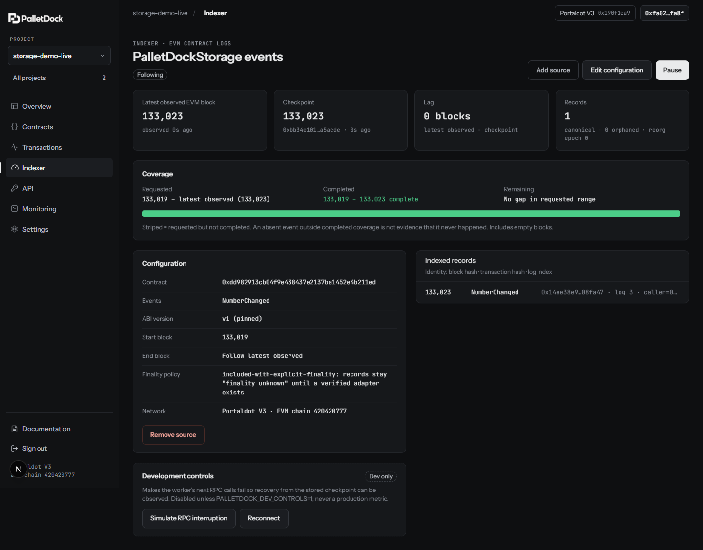

# PalletDock

**From contract transactions to application data.**

A developer workspace for Solidity builders on **Portaldot V3 Testnet**. Deploy or connect a contract, track its transactions, index its events, and expose the data to your application from one project.

[Website](https://palletdock.vercel.app/) · [Open workspace](https://palletdock.vercel.app/app) · [Documentation](https://palletdock.vercel.app/docs) · [Testnet evidence](docs/TESTNET_EVIDENCE.md)



*Actual workspace from the recorded 21 October 2026 testnet run, using a local application stack connected to Portaldot V3. This screenshot shows that run's state, not the current hosted deployment.*

**Status:** working testnet MVP, with a hosted web app, API, worker, and private database. The developer workspace requires owner login. The [public read-only integration example](https://palletdock.vercel.app/consumer) can be explored without workspace access; it demonstrates an application consuming PalletDock's API. To try the full workspace yourself, follow [Quick start](#quick-start) and create your own local owner.

## The problem

A deployed contract still needs an application around it. Solidity developers must keep artifacts and ABIs, interpret receipts, run an indexer, expose data, and investigate failures across separate tools. A successful transaction does not mean the application's indexed data is current.

PalletDock connects those steps in one workspace and makes transaction outcomes, indexing progress, and freshness visible. Inclusion, execution, indexing, and finality remain separate facts.

## A connected developer workflow

**Project → Contract → Transaction → Indexed event → Application API**

1. **Create a project.** Keep contracts, transactions, event sources, and API access in the same network context.
2. **Deploy or import a contract.** Validate its artifact and ABI, inspect reads, and review writes before wallet signing.
3. **Track the outcome.** Inspect the receipt, execution result, indexing status, and receipt-tracking condition.
4. **Index selected events.** Follow checkpoints, decoded records, reorganization handling, and recovery conditions.
5. **Connect your application.** Query project data through scoped read keys and monitor the worker and RPC observations.

See the [testnet walkthrough](docs/WALKTHROUGH.md) for the detailed steps.

## What is implemented

| Workspace area | What you can do |
| --- | --- |
| Projects | Create and switch projects, export without secrets, archive, and restore inside an owner-isolated workspace |
| Contracts | Deploy or import contracts, manage ABI versions, call reads, and prepare wallet-signed writes with supported estimates and error decoding |
| Transactions | Inspect inclusion, execution, indexing, finality, and tracking conditions, including pruned receipts and reorganized transactions |
| Indexer | Configure EVM event sources, inspect raw and decoded logs, follow checkpoints, and see retry or recovery-required states |
| API | Query contracts, transactions, events, and indexer status through scoped, expiring, revocable keys and snapshot pagination |
| Monitoring | Inspect RPC observations, worker activity, indexing progress, and operational logs |

The [consumer example](docs/CONSUMER.md) is a separate app-side reader of the public `/v1` API. It shows how another application can display indexed values, coverage, freshness, and unknown finality while keeping its read key server-side.

## Why Portaldot V3

The current integration combines Solidity contract workflows with V3's native runtime context:

| V3 capability | How PalletDock uses it |
| --- | --- |
| EVM execution and JSON-RPC | Solidity deployment, contract reads and writes, receipt tracking, and event queries |
| `reviveApi.accountId` | EVM-to-native account mapping with block and runtime provenance for account and funding context |
| Supported Revive runtime dry runs | Storage-deposit information before signing; unavailable estimates stay explicitly unavailable |
| Native genesis, EVM chain ID, and runtime identity | A pinned network fingerprint; an identity mismatch halts work until an explicit network-reset migration |
| Runtime metadata, including `revive.nativeToEthRatio` | Verification of EVM denomination before displaying interpreted amounts; raw quantities remain lossless |

These integrations are documented with [network setup](docs/NETWORK.md) and [live capability measurements](docs/TESTNET_EVIDENCE.md#live-capabilities-2026-10-17-pnpm-networkcapabilities-read-only). General contract and indexing workflows can be adapted to other networks; the implemented account mapping, deposit diagnostics, and unit policy target the verified V3 runtime.

## Testnet evidence

The demonstration contract is **PalletDockStorage** at `0xdd982913cb04f9e438437e2137ba1452e4b211ed` on EVM chain **420420777**.

| Run | Verified result | Evidence |
| --- | --- | --- |
| Deploy → write → index → API, 21 Oct 2026 | Deployed bytecode matched the compiled artifact; `store(42)` executed; indexed event identity matched the receipt and was served through the read API | [Acceptance run and screenshots](docs/evidence/2026-10-21-live/) |
| RPC interruption and worker restart, 21 Oct 2026 | Injected RPC failures recovered from the checkpoint; a write sent while the worker was stopped appeared once after restart | [Interruption](docs/evidence/2026-10-21-live/rpc-interruption/) · [Restart](docs/evidence/2026-10-21-restart/) |
| App-side stale state and recovery, 21 Oct 2026 | Consumer retained 43 with a stale warning, then displayed 44 with three unique events; reload and refresh retained the count | [Recorded consumer run](docs/evidence/2026-10-21-consumer-new-event/) |
| Tip reorganizations, 21 Oct 2026 | Twenty observed tip reorganizations, at most three blocks deep, were rolled back without orphaned records in the recorded run | [Reorganization evidence](docs/TESTNET_EVIDENCE.md#live-tip-reorganizations-2026-10-21) |
| Hosted indexing after the head-log fix, 24 Oct 2026 | `store(46)` at block 170355 was indexed with matching event identity; the public consumer retained its two rows after reload | [Hosted verification and remaining gap](docs/evidence/2026-10-24-hosted-missed-log/) |

The 21 October runs used a local application stack connected to the real testnet. Deployment and the first writes were signed through the UI using a scripted EIP-1193 signer, rather than a MetaMask approval popup. The 24 October verification used the hosted Railway worker. [Full hashes, measurements, and signing details](docs/TESTNET_EVIDENCE.md) are retained separately.

**Known historical gap:** the hosted worker previously missed `store(45)` when the RPC exposed a head block before its logs were queryable. The fix adds a default three-block indexing delay and bounded bloom-based checks for suspicious empty results in short ranges. That event was not recovered after its history aged out. The mitigation and a subsequent successful write are documented; complete history and zero data loss are not guaranteed.

## Architecture and hosting

| Component | Implementation | Hosted demo |
| --- | --- | --- |
| Web | Next.js, React, Tailwind CSS | Vercel |
| API | Fastify, TypeScript, viem | Railway |
| Worker | Independent event indexer, receipt tracker, and network probes | Railway; stays running |
| Database | PostgreSQL, transactional checkpoints and event commits | Railway; private network |

The web proxies API requests through `/backend/*`. The API and worker share PostgreSQL. Wallet signing stays on the client; the consumer's scoped read key stays on the web server.

See [architecture](docs/ARCHITECTURE.md) and the [hosted deployment guide](docs/DEPLOYMENT.md) for service configuration, secrets, migrations, and acceptance checks.

## Quick start

Requirements: **Node.js 22+** and **pnpm 11+**. Local PostgreSQL is provided by `embedded-postgres` or Docker.

From the repository root:

```bash
pnpm install --frozen-lockfile
cp .env.example .env
```

Set `PALLETDOCK_CURSOR_SECRET` in `.env` to a fresh random value. The example configuration uses API port **4100**, web port **3000**, and database port **55432**.

Start PostgreSQL in its own terminal and leave it running:

```bash
pnpm db:start
# Alternatively: docker compose up -d postgres
```

In another terminal, initialize the database and create the local owner:

```bash
pnpm db:migrate
pnpm owner:create --email you@example.com
```

The owner command prompts for a password of at least 12 characters. Running it again for the same email resets only that account and revokes only its sessions.

Self-service registration is disabled by default. Set `PALLETDOCK_SIGNUP_MODE=invite` with a server-side `PALLETDOCK_SIGNUP_INVITE_CODE` of at least 16 characters to let users create their own isolated accounts at `/signup`. `open` mode removes the code requirement, but should not be exposed without deployment-level CAPTCHA, quotas, and abuse monitoring.

Start the API and worker in separate terminals:

```bash
pnpm dev:api
```

```bash
pnpm dev:worker
```

Start the web app in another terminal. Export the API URL explicitly so the Next.js proxy uses the matching port:

```bash
PALLETDOCK_API_URL=http://127.0.0.1:4100 pnpm dev:web
```

On PowerShell, use:

```powershell
$env:PALLETDOCK_API_URL = 'http://127.0.0.1:4100'
pnpm dev:web
```

Open [the local workspace](http://127.0.0.1:3000/app) and sign in with the owner you created. Follow the [walkthrough](docs/WALKTHROUGH.md) to configure a recent event source. `pnpm network:verify` performs an optional read-only network identity probe.

### Windows service helper

After starting the database separately, the helper can manage API, worker, and web processes. With the example API port:

```powershell
$env:PALLETDOCK_API_URL = 'http://127.0.0.1:4100'
powershell -File scripts/dev-services.ps1 start
```

Replace `start` with `stop`, `restart`, or `status`. Add `-Only worker` or `-Only api,web` to select services. PIDs and logs are stored in `.data/`.

### Docker

With `.env` configured:

```bash
docker compose --profile app up -d
docker compose run --rm owner --email you@example.com
```

The repository's compose image build and boot checks run in CI. The hosted API and worker use `Dockerfile.railway`; the compose and hosted deployment paths are distinct. See [deployment instructions](docs/DEPLOYMENT.md) before configuring hosted services.

## Verification

```bash
pnpm typecheck
pnpm test
pnpm --filter @palletdock/contracts check
pnpm --filter @palletdock/web build
```

Unit and PostgreSQL integration tests cover transaction tracking, indexing, API access, and consumer reconciliation. Contract checks compare committed artifacts with a fresh compile.

For browser tests, install Chrome and start the isolated fixture stack, then run E2E in another terminal:

```bash
pnpm --filter @palletdock/web exec playwright install chrome
pnpm e2e:stack
```

```bash
pnpm e2e:fixture
```

The fixture uses a **local Hardhat chain**, not Portaldot, and labels the UI **FIXTURE NETWORK**. Its ports are 3199/4199/8599. Stop it with Ctrl+C or `scripts/e2e-stack-stop.ps1` on Windows.

[CI](https://github.com/zkzora/palletdock/actions/workflows/ci.yml) runs on pull requests and manual dispatch. Its jobs cover artifact reproducibility, type checking, tests, the web production build, fixture E2E, and Docker compose checks. Recorded results and their revisions are in [implementation status](docs/IMPLEMENTATION_STATUS.md); they are not a claim that every later commit has had the same checks rerun.

## Limits and scope

- **Single RPC trust:** recorded values and coverage reflect one node's responses, not a cryptographic proof of completeness.
- **Finality is unverified:** the node answers `safe` and `finalized` tags, but no tested adapter independently links EVM records to native finality. PalletDock reports **Unknown: not confirmed**. The indexing delay does not establish finality.
- **History may be unrecoverable:** the public RPC served only the last 258 blocks when measured on 17 October 2026. This was an endpoint observation, not a permanent network guarantee. An aged-out checkpoint can require a recent start block, leaving a historical gap.
- **Freshness is not completeness:** a recent worker observation does not prove that every historical event was captured. Snapshot metadata and tracking conditions must be interpreted together.
- **No exactly-once downstream guarantee:** event identity and consumer reconciliation prevent duplicate rows in the demonstrated view; external side effects require their own safeguards.
- **Testnet MVP:** not audited or production-ready. Native signing/events, Assets/Uniques/Nfts management, ink!, bridges, finality proofs, tracing, source verification, team roles, and billing are not implemented.

Read [limitations](docs/LIMITATIONS.md), [API semantics](docs/API.md), and [consumer behavior](docs/CONSUMER.md) before integrating. PalletDock is an independent project, not an official Portaldot service.

## Repository layout

```text
apps/web            Next.js workspace, landing page, and documentation
apps/api            Fastify owner/workspace routes and public /v1 read API
apps/worker         Event indexer, receipt tracker, and network probes
packages/chain      EVM JSON-RPC and Substrate runtime adapters
packages/shared     Network configuration, lossless quantities, and validation
packages/db         PostgreSQL migrations and owner CLI
packages/contracts  Sample Solidity contracts and reproducible artifacts
packages/e2e-chain  Local Hardhat chain for fixture tests
docs/               Guides, API specification, status, and testnet evidence
```

## Documentation

- [Walkthrough](docs/WALKTHROUGH.md) — contract-to-API testnet workflow
- [Architecture](docs/ARCHITECTURE.md) — processes, data model, and indexing
- [Network guide](docs/NETWORK.md) — identity, account mapping, and units
- [API guide](docs/API.md) · [OpenAPI specification](docs/openapi.yaml)
- [Consumer example](docs/CONSUMER.md) — application integration and freshness
- [Hosted deployment](docs/DEPLOYMENT.md) — Vercel, Railway, and acceptance checks
- [Testnet evidence](docs/TESTNET_EVIDENCE.md) · [Recorded artifacts](docs/evidence/)
- [Troubleshooting](docs/TROUBLESHOOTING.md) · [Limitations](docs/LIMITATIONS.md)
- [Implementation status](docs/IMPLEMENTATION_STATUS.md) · [Developer handoff](docs/HANDOFF.md)
- [In-app documentation](https://palletdock.vercel.app/docs)
